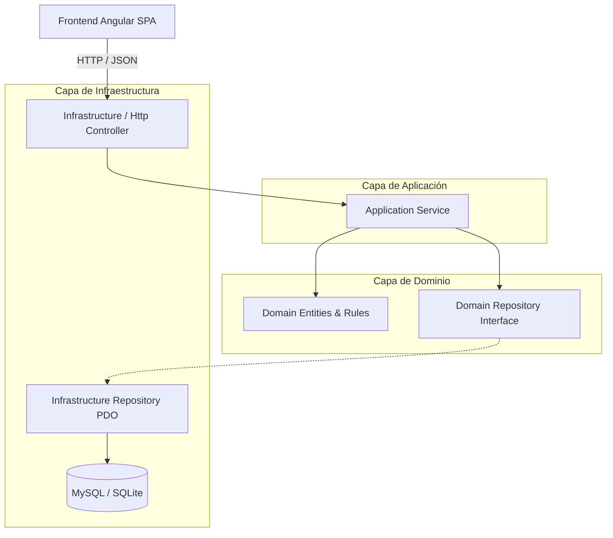
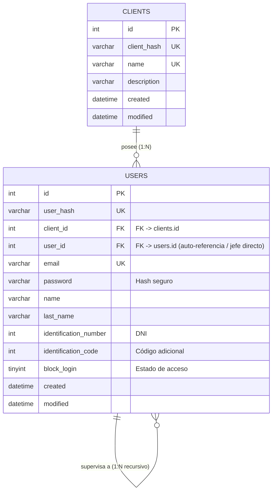

# 🏢 Organigrama Multi-Tenant & Gestión Jerárquica de Personal

[](https://www.php.net/)
[](https://angular.dev/)
[](https://primeng.org/)
[](https://www.mysql.com/)
[-success?logo=checkmarx&logoColor=white)](./tests)
[](#-arquitectura-del-software)
[](LICENSE)

Sistema integral de gestión de personal, jerarquías organizacionales y organigramas visuales con soporte multi-empresa (**multi-tenant**). Diseñado con principios de **Clean Architecture**, alta cohesión, bajo acoplamiento y resiliencia en capa de datos (MySQL 8+ con fallback transparente a SQLite).

---

## 📑 Tabla de Contenidos

- [Descripción General](#-descripción-general)
- [Stack Tecnológico](#-stack-tecnológico)
- [Arquitectura del Software](#-arquitectura-del-software)
- [Modelo y Arquitectura de Datos](#-modelo-y-arquitectura-de-datos)
- [Características Principales](#-características-principales)
- [API RESTful](#-api-restful)
- [Instalación y Puesta en Marcha](#-instalación-y-puesta-en-marcha)
  - [Requisitos Previos](#requisitos-previos)
  - [Ejecución Rápida con `./run.sh`](#ejecución-rápida-con-runsh)
  - [Base de Datos con Docker (Opcional)](#base-de-datos-con-docker-opcional)
- [Suite de Pruebas Automatizadas](#-suite-de-pruebas-automatizadas)
- [Variables de Entorno](#-variables-de-entorno)
- [Estructura del Repositorio](#-estructura-del-repositorio)

---

## 🌟 Descripción General

Este proyecto resuelve el modelado y visualización de estructuras corporativas dinámicas de cualquier profundidad. Permite a múltiples organizaciones (tenants) gestionar sus plantillas de colaboradores, definir dependencias jerárquicas directas, detectar y prevenir anomalías organizacionales (como ciclos o referencias cruzadas entre empresas), y emitir organigramas limpios listos para impresión o exportación.

---

## 🛠 Stack Tecnológico

### Backend
- **PHP 8.2+ / 8.5+** con tipado estricto (`declare(strict_types=1)`).
- **PDO Nativo** sin dependencias de frameworks pesados, con soporte unificado de transacciones y sentencias preparadas.
- **Clean Architecture & Domain-Driven Design (DDD)** con separación estricta en capas: Domain, Application, Infrastructure.
- **Router REST Ligero** con inyección de dependencias, CORS integrado y manejo unificado de excepciones de dominio.

### Frontend
- **Angular 17 (Standalone Components)**: Reactividad mediante RxJS, arquitectura modular moderna y separación de responsabilidades.
- **PrimeNG 17**: Componentes UI enriquecidos (`p-organizationChart`, `p-table`, `p-dialog`, `p-dropdown`, `p-toast`).
- **SCSS Modular**: Sistema de diseño pulido, paleta semántica, tipografía moderna y estilos de impresión CSS landscape aislados (`@media print`).

### Base de Datos & Persistencia
- **MySQL 8.4 / 8.0**: Motor principal relacional con Foreign Keys, índices compuestos y triggers de integridad.
- **SQLite 3**: Fallback automático y transparente si MySQL no está disponible, garantizando que el sistema funcione *out-of-the-box* sin servicios externos.

---

## 🏛 Arquitectura del Software

El backend sigue las directrices de **Clean Architecture**:



### Reglas de Dominio Clave
1. **Unicidad de Raíz**: Cada empresa posee un único líder supremo (CEO / Nivel 1) con `user_id = NULL`.
2. **Aislamiento Multi-Tenant**: Ningún usuario puede supervisar a un colaborador de otra organización.
3. **Aciclicidad Garantizada**: Se comprueba exhaustivamente la ausencia de dependencias circulares (directas o indirectas) tanto en el dominio como mediante triggers en el motor relacional.
4. **Reestructuración Atómica**: Si un subordinado es promovido a la posición de su superior, la jerarquía se invierte de manera transaccional sin dejar nodos huérfanos.

---

## 🗄 Modelo y Arquitectura de Datos

El diseño relacional se fundamenta en un modelo de **2 tablas minimalistas y altamente normalizadas**, optimizadas mediante índices compuestos:



### Claves e Índices Destacados
- **Auto-referencia `user_id`**: Apunta a `users.id`. Si es `NULL`, representa el Nivel 1 (CEO).
- **Índice compuesto `idx_users_client_hierarchy` (`client_id`, `user_id`)**: Garantiza búsquedas en tiempo constante $O(1)$ de raíces y subordinados directos sin escanear la tabla completa.
- **Triggers de Integridad (MySQL / SQLite)**:
  - `trg_users_before_insert_hierarchy`: Valida que el jefe pertenezca al mismo tenant.
  - `trg_users_before_update_hierarchy`: Previene auto-referencias (`id = user_id`), saltos entre tenants y ciclos jerárquicos.

---

## 🚀 Características Principales

- **Aislamiento Multi-Tenant**: Gestión independiente de múltiples compañías con conmutación en tiempo real desde la barra superior.
- **Búsqueda Dinámica en Vivo**: Filtrado reactivo al escribir en la tabla ABM enfocado exclusivamente en el nombre del colaborador.
- **Formateo Regional de DNI**: Separador de miles con puntos (`36.777.888 (1008)`) para claridad visual y prolijidad.
- **Organigrama Interactivo & Visual**: Representación jerárquica con tarjetas diferenciadas por colores según el nivel de mando (Nivel 1 Dorado, Nivel 2 Azul, Nivel 3 Esmeralda, etc.).
- **Impresión Profesional Limpia**: Botón "Imprimir Organigrama" optimizado con `@media print` en orientación horizontal (*landscape*), que elimina controles, modales y barras de navegación para generar PDFs listos para presentar.
- **Exportación JSON Estructurada**: Descarga con un clic del árbol completo de la organización con sus métricas computadas.
- **Eliminación Segura con Reasignación**: Modal inteligente al eliminar colaboradores con personal a cargo:
  - Reasignación al superior inmediato (*abuelo*).
  - Designación atómica de un nuevo jefe/sucesor (con auto-promoción si es subordinado).
- **Métricas Organizacionales en Tiempo Real**: Cálculo instantáneo de profundidad jerárquica, span de control promedio, cantidad de líderes y colaboradores individuales.

---

## 🔌 API RESTful

Todas las respuestas utilizan formato estándar JSON:

| Método | Endpoint | Descripción |
| :--- | :--- | :--- |
| `GET` | `/api/clients` | Lista todas las empresas (tenants) disponibles |
| `GET` | `/api/clients/{clientId}/organigrama` | Árbol jerárquico PrimeNG y métricas calculadas |
| `GET` | `/api/clients/{clientId}/users` | Lista plana de colaboradores ordenada por nivel (BFS) |
| `GET` | `/api/clients/{clientId}/users/{userId}` | Detalle de un usuario específico |
| `POST` | `/api/clients/{clientId}/users` | Registra un nuevo colaborador validando jerarquía |
| `PUT` | `/api/clients/{clientId}/users/{userId}` | Actualiza datos y estructura jerárquica |
| `DELETE`| `/api/clients/{clientId}/users/{userId}` | Elimina usuario ejecutando la estrategia de reasignación |
| `POST` | `/api/seed/reset` | Reinicializa la base de datos con los datos de prueba |

---

## 📦 Instalación y Puesta en Marcha

### Requisitos Previos
- **PHP >= 8.2** (con extensiones `pdo` y `pdo_sqlite` habilitadas).
- **Node.js >= 18** y **NPM**.
- *(Opcional)* Docker y Docker Compose para MySQL.

### Ejecución Rápida con `./run.sh`

El proyecto incluye un script de automatización integral con manejo de señales `SIGINT/SIGTERM` y detección automática de dependencias:

```bash
# 1. Clonar el repositorio
git clone https://github.com/nextentity/OrganigramaModule.git
cd OrganigramaModule

# 2. Dar permisos de ejecución
chmod +x run.sh

# 3. Flujo completo end-to-end (Tests + Seed + Build + Servidor Web)
./run.sh
```

Al ejecutar `./run.sh`, el sistema estará disponible en:
- **Aplicación Web**: [http://127.0.0.1:8080](http://127.0.0.1:8080)
- **Organigrama**: [http://127.0.0.1:8080/organigrama](http://127.0.0.1:8080/organigrama)
- **ABM de Personal**: [http://127.0.0.1:8080/usuarios](http://127.0.0.1:8080/usuarios)
- **API REST**: [http://127.0.0.1:8080/api/clients](http://127.0.0.1:8080/api/clients)

### Flags del Script `./run.sh`

| Comando | Acción |
| :--- | :--- |
| `./run.sh` | Ejecuta verificación, suite de tests, sembrado, compilación de Angular e inicia el servidor. |
| `./run.sh --serve` | Inicia el servidor web (compilando el frontend si no existe). |
| `./run.sh --test` | Ejecuta únicamente los 41 tests automatizados de backend. |
| `./run.sh --fresh` | Recrea el esquema de base de datos desde cero, siembra datos y levanta la app. |
| `./run.sh --build-only` | Ejecuta tests, seed y compila el frontend de producción sin levantar el servidor. |

### Base de Datos con Docker (Opcional)

Si deseas utilizar MySQL 8.4 en lugar del fallback automático SQLite:

```bash
# Iniciar contenedor MySQL 8.4
docker compose up -d

# Ejecutar el sistema (detectará MySQL en 127.0.0.1:3306)
./run.sh
```

---

## 🧪 Suite de Pruebas Automatizadas

El proyecto incluye una suite exhaustiva de pruebas unitarias y de integración que validan integridad arquitectónica, lógica de negocio y seguridad en concurrencia:

```bash
php tests/run.php
# o bien
./run.sh --test
```

### Resumen de Pruebas (41 Tests · 172 Aserciones)
- **`OrganigramaServiceTest`** (11 tests): Listado jerárquico por niveles, validaciones, inversión jerárquica con promoción, eliminación con reasignación y protección del último usuario de la empresa.
- **`ConnectionFactoryTest`** (4 tests): Verificación de claves foráneas SQLite, fallback automático ante caída de MySQL y validación de identificadores de base de datos.
- **`OrganizationSeederTest`** (6 tests): Idempotencia de semillas, generación de árboles sanos, hashing de contraseñas y transaccionalidad con rollback.
- **`SchemaIntegrityTest`** (9 tests): Detección y rechazo de ciclos directos e indirectos, rechazo de supervisores cross-tenant, auto-referencias y cascada de eliminación.
- **`SqlScriptParserTest`** (2 tests): División de sentencias complejas y delimitadores de triggers (`DELIMITER $$`).
- **`ApiEndpointTest`** (9 tests): Pruebas de integración HTTP end-to-end de todos los endpoints REST.

---

## ⚙ Variables de Entorno

Puedes personalizar la configuración copiando `.env.example` a `.env`:

```ini
# Driver principal: mysql | sqlite
DB_CONNECTION=mysql

# Configuración MySQL
DB_HOST=127.0.0.1
DB_PORT=3306
DB_DATABASE=organigrama
DB_USERNAME=root
DB_PASSWORD=
DB_CONNECT_TIMEOUT=2

# Fallback automático a SQLite si MySQL no responde
DB_FALLBACK_TO_SQLITE=true
DB_SQLITE_PATH=storage/database/organigrama.sqlite

# Credencial por defecto del seed
SEED_DEFAULT_PASSWORD=Demo1234!
```

---

## 📁 Estructura del Repositorio

```text
OrganigramaModule/
├── config/                 # Configuración de base de datos PDO
├── database/
│   ├── fixtures/           # Fixtures de empresas y empleados de prueba
│   ├── schema/             # Esquemas DDL y triggers para MySQL y SQLite
│   └── seed.php            # Script de migración y seeding idempotente
├── frontend/               # Aplicación SPA Angular 17 + PrimeNG
│   └── src/app/
│       ├── components/
│       │   ├── org-chart/  # Componente visual del organigrama
│       │   └── user-abm/   # Componente ABM de personal con modales
│       ├── models/         # Interfaces TypeScript del dominio
│       └── services/       # Servicios de consumo de la API REST
├── public/                 # Punto de entrada web (Front Controller & Router)
├── src/                    # Backend PHP (Clean Architecture)
│   ├── Application/        # Casos de uso y servicios de aplicación
│   ├── Domain/             # Entidades, modelos de árbol y excepciones
│   └── Infrastructure/     # Controladores HTTP, Repositorios PDO y DB
├── storage/                # Almacenamiento local (SQLite y logs)
├── tests/                  # Suite de pruebas automatizadas
├── docker-compose.yml      # Servicio MySQL 8.4 opcional
├── run.sh                  # Orquestador end-to-end de la aplicación
└── README.md               # Documentación general del proyecto
```

---

## 📄 Licencia

Este proyecto está bajo la Licencia **MIT**. Consulta el archivo [LICENSE](LICENSE) para más detalles.

